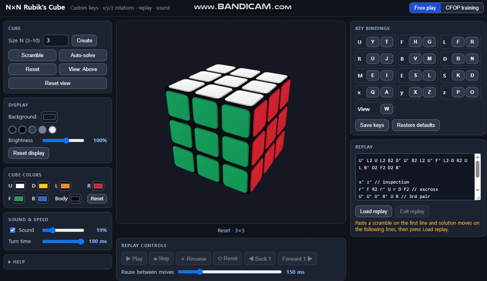

# 🧊 N×N Rubik's Cube Simulator

An interactive, browser-based 3D Rubik's Cube simulator built with **Three.js** and vanilla JavaScript. Designed for both casual solvers and speedcubers, it supports dynamic cube dimensions from $2\times2$ up to $10\times10$, customizable keyboard controls, procedural Web Audio sound effects, a notation replay engine, and an interactive **CFOP Training Mode**.



---

## ✨ Features

* **Dynamic $N\times N$ Cube Generation:** Seamlessly generate and interact with cubes ranging from $2\times2$ to $10\times10$ in real time.
* **Speedcube Aesthetics:** Features rounded black plastic cubie bodies paired with beveled, satin-textured tiles for realistic visual feedback.
* **Custom Key Bindings:** Map any face turn (`U`, `D`, `L`, `R`, `F`, `B`), inner slice (`M`, `E`, `S`), whole-cube rotation (`x`, `y`, `z`), or mirror view toggle to your preferred keyboard layout with built-in duplicate conflict detection.
* **Procedural Audio Engine:** Uses the native **Web Audio API** to synthesize mechanical turning clicks and sliding noises with dynamic pitch variation and volume controls.
* **Algorithm Replay & Parser:** Paste standard WCA notation scrambles and annotated multi-line solves (using `//` comments for step labels) to step forward, backward, or play back reconstructions automatically.
* **Built-In CFOP Trainer:** Includes a complete interactive library of **125+ algorithms** across all four CFOP stages:
  * **Cross:** Standard Cross, X-Cross, and Double X-Cross examples.
  * **F2L:** All 41 standard front-right slot cases.
  * **OLL:** All 57 last-layer orientation cases.
  * **PLL:** All 21 last-layer permutation cases.
* **Customizable Environment:** Adjust background colors, scene brightness, animation turn speed, and individual sticker/body colors on the fly.

---

## 🚀 Getting Started

Because this project uses vanilla HTML, CSS, and JavaScript with Three.js loaded via CDN, **no build tools, bundlers, or package installations are required.**

### Running Locally

1. **Clone the repository:**
   ```bash
   git clone https://github.com/your-username/nxn-rubiks-cube-simulator.git
   cd nxn-rubiks-cube-simulator
   ```

2. **Open in your browser:**
   * Simply double-click `index.html` to open it directly in any modern web browser, **or**
   * Serve it using a lightweight local server (recommended):
     ```bash
     # Using Python 3
     python -m http.server 8000
     ```
     Then navigate to `http://localhost:8000` in your browser.

---

## 🎮 Controls & Usage

### Camera & View
* **Rotate Camera:** Click and drag anywhere on the 3D canvas.
* **Zoom:** Scroll with the mouse wheel or trackpad.
* **Mirror View (YZ Plane):** Press `W` (default) or click **View: Above** to smoothly flip the camera angle to inspect back/bottom pieces.

### Default Key Bindings
Every slice supports both clockwise (forward) and counter-clockwise (inverse) turns:

| Move | Clockwise | Counter-Clockwise (`'`) | Description |
| :--- | :---: | :---: | :--- |
| **U** | `Y` | `T` | Up (Top) face |
| **D** | `B` | `N` | Down (Bottom) face |
| **L** | `F` | `R` | Left face |
| **R** | `U` | `J` | Right face |
| **F** | `H` | `G` | Front face |
| **B** | `V` | `M` | Back face |
| **M** | `E` | `I` | Middle slice (follows L) |
| **E** | `S` | `L` | Equatorial slice (follows D) |
| **S** | `K` | `D` | Standing slice (follows F) |
| **x** | `Q` | `A` | Rotate entire cube on R axis |
| **y** | `X` | `Z` | Rotate entire cube on U axis |
| **z** | `P` | `O` | Rotate entire cube on F axis |

> *Tip: Click any key button in the **Key bindings** panel, press a letter (`A–Z`), and click **Save keys** to customize your layout.*

---

## 📝 Replay Notation Format

In **Free play** mode, use the **Replay** panel on the right to visualize solve reconstructions:

* **Line 1:** Must contain the setup scramble.
* **Subsequent Lines:** Contain solution steps. Anything after `//` is parsed as a step label.
* **Supported Notation:** Standard outer turns (`U D L R F B`), wide turns (`r` or `Rw`), slice moves (`M E S`), rotations (`x y z`), double turns (`2`), and primes (`'`).

#### Example Input:
```text
U' L2 U L2 B2 D' U' B2 L2 U' F' L2 D R2 U L B' D2 F2 D2 R'

x' z' // Inspection
r' F R2 r' U r D F2 // Double X-Cross
U' U' U' R' U R // 3rd Pair
U' R U R' // 4th Pair
R U R' U R U2' R' // OLL(CP)
U // AUF
```

---

## 📁 Project Structure

```text
├── index.html      # Main application layout, control panels, and Three.js CDN import
├── styles.css      # Responsive 3-column dark-theme UI styling
├── script.js       # Three.js 3D engine, animation queue, Web Audio synth, parser, and CFOP data
└── README.md       # Project documentation
```

---

## 🛠️ Technologies Used

* **[Three.js (v0.160.0)](https://threejs.org/):** 3D WebGL scene rendering, procedural geometry extrusion, and matrix transformations.
* **Web Audio API:** Real-time procedural sound synthesis (bandpass-filtered noise + triangle wave oscillators).
* **HTML5 Canvas:** Procedural satin texture and micro-grain generation for cube stickers.
* **CSS Grid & Flexbox:** Responsive desktop and mobile-friendly dashboard layout.

---

## 📄 License

This project is open-source and available under the [MIT License](LICENSE).